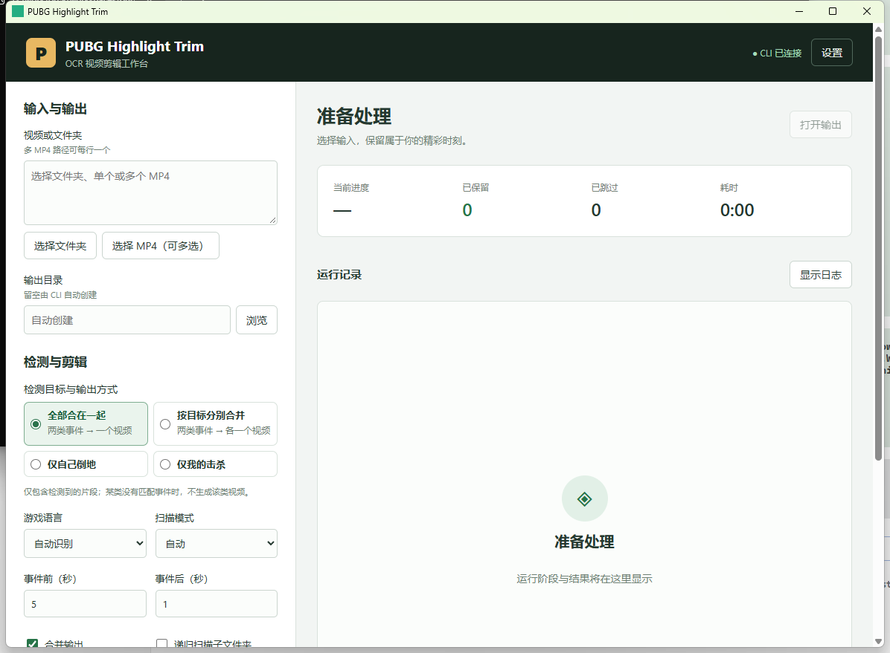

# Tauri UI migration verification (#103)

## Scope

The desktop implementation is now Tauri 2 + Vue 3 + TypeScript. The WPF application
and its implementation-specific tests have been removed. The processing CLI and
OCR/decode/trim/merge algorithms are unchanged. See ADR-0001 and ADR-0003 for the
stdout logging and automatic OCR-provider contracts.

This ticket delivers a development-runnable Windows x64 application, not an
installer or a self-contained WebView2 distribution. See [development instructions](../ui/README.md).
The existing CLI release gates remain; GUI ZIP publication is intentionally not
continued without the follow-up distribution acceptance.

## Public test boundaries

These boundaries were explicitly agreed before implementation:

1. UI workflow → Rust command interface: defaults/schema, validation/preview,
   danger confirmation, option snapshot, duplicate-start prevention and settings.
2. Rust shell → controlled external CLI: actual argument array, stdout/stderr,
   terminal outcomes, reset, cancellation, close and Windows process trees.
3. Shell → unchanged real CLI + fixed videos: semantic summary, records and media.

`ui/tests/workflow.test.ts` tests the first boundary's client contract without a
DOM. `ui/src-tauri/tests/` exercises public Rust APIs and real Windows helper
processes, not private functions. These layers are not mislabelled as one
fully automated desktop end-to-end test.

## Local verification (2026-10-21)

Host: Windows x64, Rust 1.99.1 MSVC, Node 24.21.0, installed WebView2 Runtime.

- Frontend typecheck, seven public workflow tests, production Vite build: passed.
- Rust shell `cargo check` and `cargo test`: passed (11 tests); the real-video test is opt-in.
- Existing CLI workspace full default-feature suite: 176 passed, one ignored.
  FFmpeg was supplied using `PUBG_HIGHLIGHT_TRIM_FFMPEG_DIR`. The first attempt
  without that variable failed the media prerequisite; it was not a product failure.
- PowerShell script syntax and workflow YAML parsing: passed.

### Fixed real-video comparison

Built `pubg_highlight_trim.exe` from this worktree's unchanged CLI source with
`cli,directml` and the production DirectML delay-load flags. Both paths invoked
that exact executable and the same local pinned-model/FFmpeg bundle. Two fixed
private recordings were copied to a scratch input directory: one event source
and one no-event source. No original recording was archived or overwritten.
Private filenames, hashes and logs stay outside the repository.

`real_video_shell_matches_direct_cli_decisions_records_and_decoded_media` passed:
**two sources, two decoded outputs** (one clip and one merged output). The test
compares all nonvolatile summary fields, decision/record columns, stream media
properties and decoded frame/audio hashes. Source SHA-256 values must remain unchanged. It excludes timing, output locations,
and unrelated container metadata; it does not impose an elapsed-time gate.

Reproduce with PowerShell, using fixed read-only corpus copies and a complete
current-source CLI bundle:

```powershell
$env:PUBG_UI_REAL_BUNDLE = (Resolve-Path 'dist/pubg-highlight-trim').Path
$env:PUBG_UI_REAL_INPUTS = ConvertTo-Json -Compress -InputObject @(
    'D:\fixed-corpus\event.mp4', 'D:\fixed-corpus\no-event.mp4'
)
$env:PUBG_UI_REQUIRE_MEDIA = '1'
cargo test --locked --manifest-path ui/src-tauri/Cargo.toml --test real_video -- --ignored --nocapture
```

The test does not ship private media. `PUBG_UI_REQUIRE_MEDIA` prevents an all-skipped
corpus from falsely establishing media compatibility. The Rust public `Shell`
used here is the same service used by the desktop IPC handlers.

### Visible desktop smoke

Started the real Tauri debug executable against Vite and the complete trusted CLI
layout. Through Windows accessibility actions on the visible app:

- Entered the fixed event video and output directory; Rust-generated command
  preview appeared with default parameters.
- Started processing: the app reached **处理完成**, exit code **0**, kept **1**,
  skipped **0**, with scan/dedupe/trim/merge completion and worker counts visible.
  The CLI wrote the clip, merged MP4, summary and CSV.
- Enabled overwrite, clicked Start, verified the explicit danger dialog, and
  cancelled the dialog without starting a destructive run.
- Repeated processing into a different scratch output and observed successful
  completion. A manual Stop attempt arrived after completion and therefore does
  **not** count as manual cancellation acceptance; controlled-process tests cover it.

This smoke exposed and fixed two integration defects that isolated tests missed:
Vite was watching exclusively locked WebView2 profile files, and Tauri lacked
permission for `core:event` listening. The rerun showed the connected UI without
the permission error and completed the real task. The PowerShell development build
script also passed with `-SkipCliBuild -Configuration Debug`; its copied executable
was launched without Vite and presented the connected UI from `http://tauri.localhost/`.

### Target selection presentation

The final UI uses a compact 2×2 exclusive selection: combined events in one video,
separate merges by target, self-death only, or own-kill only. The existing Rust
parameter semantics are unchanged. Native radio controls are excluded from text
input sizing; the final desktop screenshot was inspected after rebuilding.



## Review

Standards and Spec reviews were run independently. Reported documentation paths,
cache-clear scope, duplicated enum definitions, OCR jobs input normalization and
cross-run reader state fencing were corrected and rechecked. Both review axes
reported no remaining findings within their reviewed scope.

## Remaining acceptance limits

- Windows 10 and Windows 11 clean-host coverage has not been run separately.
- Automated desktop dialog/file-picker, visible close/cancel and forced-crash
  matrix remains narrower than the Rust controlled-process tests.
- Tests exercise real Job assignment, parent-exit descendants, nested/existing
  Jobs, abrupt supervisor termination with child/grandchild exit confirmation,
  and nonempty-job verification failure. They do not claim to deterministically
  reproduce every possible Windows kernel termination failure.
- Installation ACLs, ordinary-user launch at the actual installation location,
  complete runtime sourcing, upgrade/uninstall and WebView2 distribution belong
  to the follow-up distribution ticket. No installer/runtime-completeness claim
  is made here.
